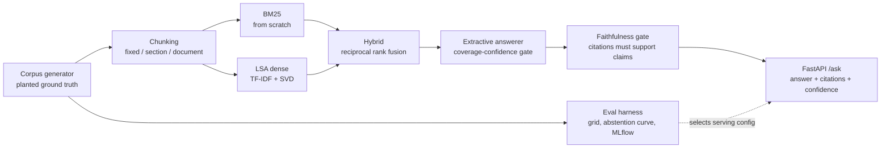

# grounded-rag-service

A RAG service that treats "I don't know" as a feature. Every answer
carries citations a reviewer can verify in seconds, a faithfulness gate
checks that the cited text actually supports the claim, and below a
measured confidence threshold the service abstains instead of guessing.
Behind it sits an evaluation harness that measures a full chunking by
retriever grid against planted ground truth, including the question
sets that most RAG demos skip: near-duplicate distractor documents and
questions with no answer in the corpus.

The punchline from the grid: retrieval metrics alone will mislead you.
Document-level chunking scores a perfect recall@1 on this corpus and
still loses the serving decision, because a citation that spans a whole
six-section page is barely a citation at all.

## Architecture



The corpus is a synthetic internal engineering handbook built for one
purpose: knowing, for every question, exactly which document and
section holds the answer (ADR 0002). One page per service, an identical
section skeleton on every page, shared boilerplate, and value-free
cross references that plant other service names into every page. That
is the enterprise-wiki failure mode: every page about every service
says "run the standard release pipeline", and the facts differ only in
entities and values. 120 target services plus 42 pure distractors, 300
answerable questions (a third of them paraphrased so exact word match
is not guaranteed), 100 questions with no answer in the corpus.

## The measured grid

recall@1 / recall@5 / MRR score section-level hits against planted
ground truth; accuracy is end-task answer accuracy at the serving gate;
cite is mean sections per citation. 300 answerable questions.

| chunking/retriever | recall@1 | recall@5 | MRR | answer acc | cite |
|---|---|---|---|---|---|
| fixed/bm25 | 0.783 | 1.000 | 0.890 | 0.830 | 3.26 |
| fixed/lsa | 0.703 | 1.000 | 0.844 | 0.819 | 3.24 |
| fixed/hybrid | 0.790 | 1.000 | 0.890 | 0.830 | 3.26 |
| section/bm25 | 0.480 | 0.893 | 0.615 | 0.806 | 1.00 |
| section/lsa | 0.460 | 0.873 | 0.590 | 0.809 | 1.00 |
| section/hybrid | 0.467 | 0.887 | 0.603 | 0.804 | 1.00 |
| document/bm25 | 1.000 | 1.000 | 1.000 | 0.852 | 6.00 |
| document/lsa | 1.000 | 1.000 | 1.000 | 0.852 | 6.00 |
| document/hybrid | 1.000 | 1.000 | 1.000 | 0.852 | 6.00 |

Three findings the grid forced, none of which the usual RAG demo
surfaces:

**Document-level chunking wins unconstrained accuracy and is still the
wrong serving choice.** Queries name their service, so finding the
right page is free at any corpus size; the perfect recall@1 column is
real and it is also beside the point. Page-level citations average 6.0
sections, which fails the verifiability bar. Serving-config selection
is therefore constrained optimization: maximize end-task accuracy
subject to `max_sections_per_citation: 4` (config), which selects
fixed/bm25 at 0.830 accuracy and 3.26 sections per citation. The
unconstrained winner is recorded beside the selection in the report,
not hidden.

**Hybrid fusion does not beat BM25 here, and the README says so.** On
an entity-anchored corpus the lexical leg dominates; reciprocal rank
fusion only pays when the legs disagree productively. The hybrid column
exists because measuring it honestly beats assuming it. The dense leg
is classical LSA, not a modern embedding model (ADR 0001), so read the
comparison as lexical vs a classical dense baseline.

**Retrieval difficulty had to be earned.** The first corpus version
scored recall@1 of 1.000 in six of nine cells. The fix commit added
boilerplate, cross references, and paraphrased questions; section-level
recall@1 fell to 0.48. A benchmark can go soft undetected only if no
harness would catch it, and this one did.

## The abstention curve

Confidence is the selected sentence's coverage of the question's
content terms, a calibration-free [0, 1] scale. Sweeping the gate on
300 answerable and 100 unanswerable questions (serving config):

| threshold | coverage | acc when answered | false answers | faithfulness |
|---|---|---|---|---|
| 0.0 | 1.000 | 0.573 | 1.00 | 1.0 |
| 0.3 | 0.753 | 0.668 | 0.60 | 1.0 |
| 0.4 | 0.607 | 0.830 | 0.19 | 1.0 |
| 0.5 | 0.607 | 0.830 | 0.13 | 1.0 |
| 0.6 | 0.487 | 0.877 | 0.09 | 1.0 |
| 0.7 | 0.113 | 1.000 | 0.05 | 1.0 |
| 0.8 | 0.113 | 1.000 | 0.00 | 1.0 |

The default gate ships at 0.5: answer 61 percent of answerable
questions at 0.83 accuracy with a 13 percent false-answer rate on
questions that have no answer, versus 100 percent false answers with
the gate off. A stricter deployment moves to 0.7 and trades coverage
for a 5 percent false-answer rate. The point of the curve is that this
is an operating decision made on measured numbers, not a vibe.

The first gate keyed on retrieval confidence and its curve was flat:
47 to 54 percent false answers at every threshold, because the
service's page matches strongly whether or not the asked-about
attribute exists anywhere in it. Retrieval score answers "did I find
the right page"; it cannot answer "does the page contain this fact".
The fix commit carries the before and after.

## The faithfulness gate

Every non-abstained answer is checked: the content terms it asserts
must appear in the text of its cited chunks, and unsupported terms are
named in the verdict. The extractive default passes by construction,
which is what calibrates the gate; a generative provider must clear
the same bar, so a model that asserts a value its citation does not
contain gets caught before the answer ships. The Anthropic provider
behind the same protocol requires `ANTHROPIC_API_KEY`; no number in
this README depends on it.

## Retrieval benchmark

120-service corpus, 486 fixed chunks, 400 queries, single process
(x86_64, Python 3.12):

| retriever | fit (s) | queries/s | p50 (ms) | p95 (ms) |
|---|---|---|---|---|
| bm25 | 0.016 | 1638 | 0.58 | 1.00 |
| lsa | 0.143 | 1399 | 0.69 | 0.83 |
| hybrid | 0.152 | 577 | 1.67 | 2.37 |

Hybrid pays for running both legs over a 50-deep fusion pool. All fit
times are sub-second, which is what makes rebuilding the index at
container start or in CI a non-event.

## Quickstart

```bash
pip install -e ".[dev]"
python -m ragsvc.pipeline            # corpus, grid, curve -> artifacts/
pytest -q                            # 31 tests
uvicorn ragsvc.service.app:create_app --factory --port 8000
```

```bash
curl -s localhost:8000/ask -X POST -H 'content-type: application/json' \
  -d '{"question": "What is the rate limit for quartz-courier?"}'
# {"answer":"The rate limit for quartz-courier is ...","abstained":false,
#  "confidence":1.0,"citations":["doc-quartz-courier:w90"],"supported":true}
```

Ask about something the handbook does not document and the service
says so: `abstained: true`, no invented answer, HTTP 200 because "not
in the handbook" is a valid answer rather than a server error.

MLflow tracking of grid runs: `pip install -e ".[tracking]"` then
`python -m ragsvc.pipeline --mlflow` (logs to `sqlite:///mlflow.db`;
`MLFLOW_TRACKING_URI` wins when set). Docker: `docker compose up`
bakes the corpus at build and serves on 8000.

## Failure modes and honest boundaries

- The dense retriever is LSA, not a modern embedding model. The
  interface accepts one; the measured numbers here do not include one
  (ADR 0001).
- The faithfulness check is lexical support, not entailment. It
  catches fabricated values and entities; it cannot catch a claim
  assembled misleadingly from supported terms, and it would flag a
  correct paraphrase using words absent from the citation.
- Template-generated text is easier than real prose. Absolute numbers
  flatter every retriever; the comparative findings are the output
  that transfers.
- Roughly 17 percent of answered questions at the default gate are
  wrong, dominated by paraphrases whose attribute words appear nowhere
  in the corpus, where coverage confidence cannot separate the gold
  sentence from boilerplate sharing the same verb.
- Single-process service, index in memory, no persistence layer, no
  auth. Those are deployment concerns this repo deliberately keeps out
  of scope.

## Repository layout

```
src/ragsvc/
  corpus/       generator (planted ground truth), chunking strategies
  retrieval/    bm25 (from scratch), dense LSA, hybrid RRF
  answer/       extractive answerer, faithfulness gate, providers
  eval/         grid harness, abstention curve, MLflow logging
  service/      FastAPI app
config/         default.yaml (corpus, gate, citation budget)
docs/adr/       0001 offline stack, 0002 synthetic corpus, 0003 boring choices
benchmark/      latency benchmark with committed results
tests/          31 tests: hand-computed BM25, gate regressions, oracle pins
```
